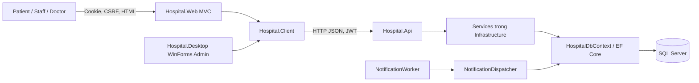
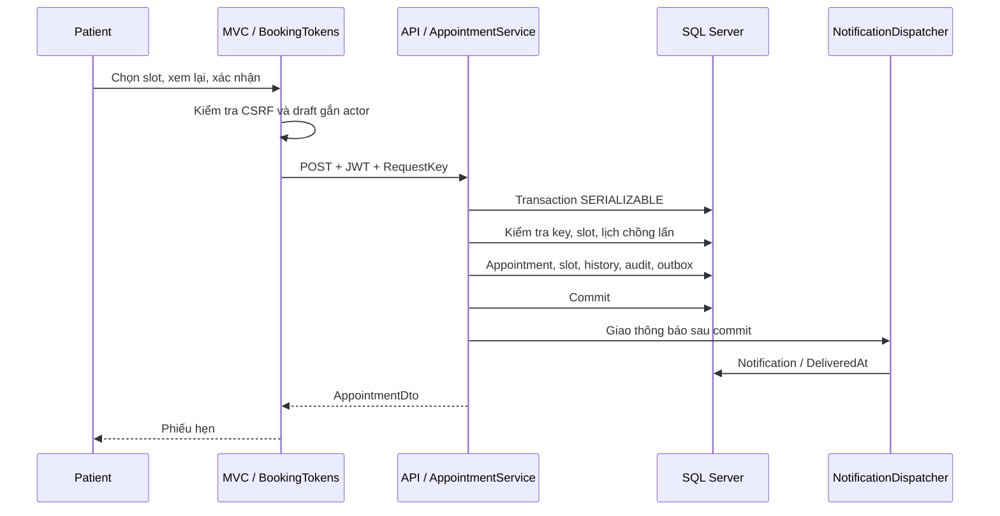

# Kiến trúc triển khai — Phase 8

Tài liệu mô tả mã nguồn đang chạy, cập nhật ngày 19/10/2026. Hệ thống quản lý lịch khám, không bao gồm bệnh án, chẩn đoán, kê đơn hay thanh toán.

## 1. Các tiến trình và dữ liệu dùng chung

Web và Desktop cùng gọi API; không tham chiếu Infrastructure và không tạo DbContext. Khi Admin tạo bác sĩ/ca trên Desktop, Patient đọc lại API sẽ thấy dữ liệu đã commit. Giao diện cần tải lại; không có push realtime/SignalR.

## 2. Trách nhiệm từng project

| Project | Thành phần thực tế | Trách nhiệm |
|---|---|---|
| `Hospital.Domain` | Entities, Enums | Tài khoản, danh mục, lịch, lịch sử, audit, notification/outbox và trạng thái |
| `Hospital.Application` | DTO, DataAnnotations, interfaces, exceptions | Hợp đồng vào/ra, validation và giao diện service |
| `Hospital.Infrastructure` | DbContext, migrations, seeder, Services | EF mapping, nghiệp vụ, transaction, hash mật khẩu, JWT và dispatcher |
| `Hospital.Api` | Controllers, middleware, CurrentUserService, worker | HTTP, xác thực/phân quyền, response có trace, tác vụ thông báo |
| `Hospital.Client` | HospitalApiClient, HospitalApiException | HTTP JSON có token, đọc DTO và lỗi cho cả hai giao diện |
| `Hospital.Web` | Controllers/Views, PortalApi, cookie events, BookingTokens | UI theo vai trò, cookie/CSRF, quy trình chọn lịch có bản xác nhận được bảo vệ |
| `Hospital.Desktop` | Forms, AdminSession, EditorForm, UiControls | Quản trị, xác nhận, validation/loading/lỗi, kết thúc phiên bị thu hồi |

Services dùng DbContext trực tiếp; không triển khai generic repository, AutoMapper hoặc CQRS. DTO được map trong service. DI khai báo ở `Infrastructure/DependencyInjection.cs` và `Program.cs` của từng host.

## 3. Một yêu cầu đặt lịch

`DatabaseWork.AtomicAsync` dùng execution strategy của EF, xóa tracking trước mỗi lượt retry, tạo transaction Serializable, chạy nghiệp vụ rồi SaveChanges/Commit. Transaction chưa commit rollback khi dispose. Kiểm tra trên UI hỗ trợ người dùng; kiểm tra quyết định nằm trong service/transaction.

Transaction bảo vệ việc đọc–ghi; RowVersion phát hiện dữ liệu đã đổi; filtered unique index ngăn hai lịch Confirmed/CheckedIn cùng chiếm một slot. Chồng lấn bệnh nhân ở hai bác sĩ được kiểm tra trong service. Cùng `(BookedBy, RequestKey)` và fingerprint trả lại lịch đã tạo; key dùng cho nội dung khác bị từ chối. Đổi/hủy mang RowVersion cũ; thất bại giữ nguyên lịch cũ.

## 4. Phiên và quyền

- API kiểm tra JWT và đọc lại IsActive, TokenVersion, role mỗi request. Khóa/đổi quyền/đổi mật khẩu thu hồi token cũ.
- Web lưu JWT trong ticket cookie được Data Protection bảo vệ, HttpOnly và SameSite=Lax. Các POST MVC có CSRF; JavaScript không quản lý bearer token.
- Desktop chỉ chấp nhận Admin, giữ token trong bộ nhớ AdminSession; hết phiên đóng form/shell và quay về đăng nhập.
- Patient dùng hồ sơ của mình; Doctor đọc lịch thuộc mình; Staff đặt hộ/tiếp nhận theo điều kiện; Admin quản trị qua Desktop. Menu ẩn không thay thế kiểm tra quyền backend.
- Development tạo khóa JWT theo process, nên restart API cần đăng nhập lại. Ngoài Development phải cấu hình secret tối thiểu 32 byte và HTTPS. Nghiệm thu này dành cho demo cục bộ.

## 5. Thời gian và thông báo

`ClinicTime` dùng `Asia/Ho_Chi_Minh`. Ngày/giờ khám là DateOnly/TimeOnly; dấu thời gian audit/outbox là UTC. UI hiển thị giờ Việt Nam. Không đổi đồng hồ máy để demo hạn hai giờ hoặc NoShow.

Outbox ghi cùng transaction lịch hẹn; dispatcher tạo Notification sau commit, worker xử lý lại các mục đến hạn. Unique `Notifications.OutboxId` ngăn trùng khi retry. Nhắc lịch lên lịch trước một giờ, có xử lý mục nhắc cũ khi đổi/hủy. Đây là thông báo trong ứng dụng, không phải email/SMS.

## 6. Lỗi, vận hành và kiểm chứng

Middleware trả `ApiResponse`, mã lỗi, TraceId; phân biệt validation, quyền, không tìm thấy, concurrency và database unavailable. Khi mất phản hồi ghi, tra cứu kết quả hoặc gửi lại cùng RequestKey. UI không tự tạo yêu cầu đặt mới để thử lại.

Auth limiter là 10 request/phút theo IP. Các lượt đăng nhập qua MVC cùng server dùng chung hạn mức; runner chờ giữa các nhóm. Script `demo.ps1` quản lý API/Web chạy ẩn, readiness, log và PID/start-time; stop giữ database.

Xem [demo-guide.md](demo-guide.md), [database-design.md](database-design.md), [technical-explanation.md](technical-explanation.md), [ma trận UC/BR](usecase-coverage.md) và [kiểm chứng Phase 8](phase8-verification.md).
