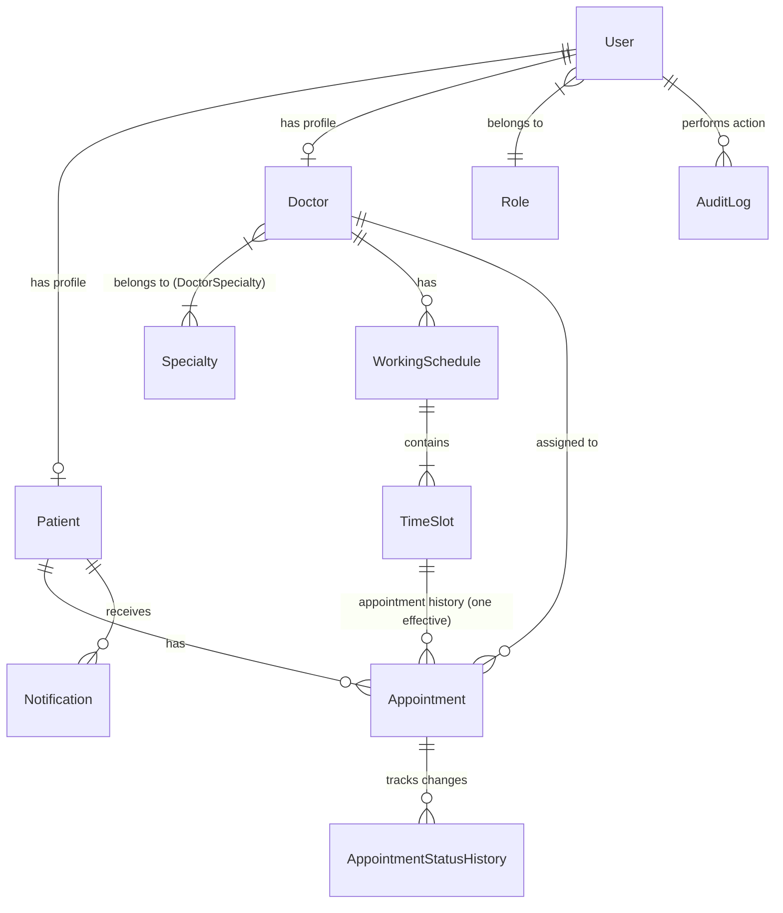

# Database Design — Hospital Appointment System

---

## 1. ERD (Entity Relationship Diagram)



---

## 2. Danh sách bảng

### 2.1. Users — Tài khoản người dùng
| Cột | Kiểu | Ràng buộc | Mô tả |
|-----|------|----------|-------|
| Id | UNIQUEIDENTIFIER | PK, DEFAULT NEWSEQUENTIALID() | Mã tài khoản |
| Username | NVARCHAR(50) | UNIQUE, NOT NULL | Tên đăng nhập |
| PasswordHash | NVARCHAR(256) | NOT NULL | Mật khẩu đã hash |
| Email | NVARCHAR(100) | UNIQUE, NOT NULL | Email |
| PhoneNumber | NVARCHAR(20) | NULL | Số điện thoại |
| FullName | NVARCHAR(100) | NOT NULL | Họ tên |
| RoleId | INT | FK → Roles.Id, NOT NULL | Vai trò |
| IsActive | BIT | NOT NULL, DEFAULT 1 | Trạng thái hoạt động |
| CreatedAt | DATETIME2 | NOT NULL, DEFAULT GETUTCDATE() | Thời điểm tạo |
| UpdatedAt | DATETIME2 | NULL | Thời điểm cập nhật |
| LastLoginAt | DATETIME2 | NULL | Lần đăng nhập cuối |

### 2.2. Roles — Vai trò
| Cột | Kiểu | Ràng buộc | Mô tả |
|-----|------|----------|-------|
| Id | INT | PK, IDENTITY | Mã vai trò |
| Name | NVARCHAR(50) | UNIQUE, NOT NULL | Tên vai trò |
| Description | NVARCHAR(200) | NULL | Mô tả |

> Seed: Patient (1), Doctor (2), Staff (3), Admin (4)

### 2.3. Patients — Hồ sơ bệnh nhân
| Cột | Kiểu | Ràng buộc | Mô tả |
|-----|------|----------|-------|
| Id | UNIQUEIDENTIFIER | PK, DEFAULT NEWSEQUENTIALID() | Mã bệnh nhân |
| UserId | UNIQUEIDENTIFIER | FK → Users.Id, UNIQUE, NOT NULL | Liên kết tài khoản |
| DateOfBirth | DATE | NOT NULL | Ngày sinh |
| Gender | TINYINT | NOT NULL | 0: Khác, 1: Nam, 2: Nữ |
| Address | NVARCHAR(300) | NULL | Địa chỉ |
| PatientCode | NVARCHAR(20) | UNIQUE, NOT NULL | Mã bệnh nhân (hiển thị) |
| CreatedAt | DATETIME2 | NOT NULL | Thời điểm tạo |
| UpdatedAt | DATETIME2 | NULL | Thời điểm cập nhật |

### 2.4. Specialties — Chuyên khoa
| Cột | Kiểu | Ràng buộc | Mô tả |
|-----|------|----------|-------|
| Id | INT | PK, IDENTITY | Mã chuyên khoa |
| Code | NVARCHAR(20) | UNIQUE, NOT NULL | Mã chuyên khoa (hiển thị) |
| Name | NVARCHAR(100) | NOT NULL | Tên chuyên khoa |
| Description | NVARCHAR(500) | NULL | Mô tả |
| IsActive | BIT | NOT NULL, DEFAULT 1 | Trạng thái hoạt động |
| CreatedAt | DATETIME2 | NOT NULL | Thời điểm tạo |
| UpdatedAt | DATETIME2 | NULL | Thời điểm cập nhật |
| CreatedBy | UNIQUEIDENTIFIER | FK → Users.Id | Người tạo |

### 2.5. Doctors — Hồ sơ bác sĩ
| Cột | Kiểu | Ràng buộc | Mô tả |
|-----|------|----------|-------|
| Id | UNIQUEIDENTIFIER | PK, DEFAULT NEWSEQUENTIALID() | Mã bác sĩ |
| UserId | UNIQUEIDENTIFIER | FK → Users.Id, UNIQUE, NULL | Liên kết tài khoản (NULL khi chưa cấp TK) |
| DoctorCode | NVARCHAR(20) | UNIQUE, NOT NULL | Mã bác sĩ (hiển thị) |
| Title | NVARCHAR(50) | NULL | Chức danh (TS., PGS., GS.) |
| Bio | NVARCHAR(1000) | NULL | Giới thiệu |
| AvatarUrl | NVARCHAR(500) | NULL | Đường dẫn ảnh đại diện |
| IsActive | BIT | NOT NULL, DEFAULT 1 | Trạng thái hoạt động |
| CreatedAt | DATETIME2 | NOT NULL | Thời điểm tạo |
| UpdatedAt | DATETIME2 | NULL | Thời điểm cập nhật |
| CreatedBy | UNIQUEIDENTIFIER | FK → Users.Id | Người tạo |

### 2.6. DoctorSpecialties — Bác sĩ – Chuyên khoa (Many-to-Many)
| Cột | Kiểu | Ràng buộc | Mô tả |
|-----|------|----------|-------|
| DoctorId | UNIQUEIDENTIFIER | PK, FK → Doctors.Id | Mã bác sĩ |
| SpecialtyId | INT | PK, FK → Specialties.Id | Mã chuyên khoa |
| IsPrimary | BIT | NOT NULL, DEFAULT 0 | Chuyên khoa chính |

### 2.7. WorkingSchedules — Lịch làm việc
| Cột | Kiểu | Ràng buộc | Mô tả |
|-----|------|----------|-------|
| Id | UNIQUEIDENTIFIER | PK | Mã lịch làm việc |
| DoctorId | UNIQUEIDENTIFIER | FK → Doctors.Id, NOT NULL | Bác sĩ |
| WorkDate | DATE | NOT NULL | Ngày làm việc |
| StartTime | TIME | NOT NULL | Giờ bắt đầu |
| EndTime | TIME | NOT NULL | Giờ kết thúc |
| Note | NVARCHAR(500) | NULL | Ghi chú |
| CreatedAt | DATETIME2 | NOT NULL | Thời điểm tạo |
| UpdatedAt | DATETIME2 | NULL | Thời điểm cập nhật |
| CreatedBy | UNIQUEIDENTIFIER | FK → Users.Id | Người tạo |

> **UNIQUE:** (DoctorId, WorkDate, StartTime) — Không chồng lấn cùng BS

### 2.8. TimeSlots — Khung giờ
| Cột | Kiểu | Ràng buộc | Mô tả |
|-----|------|----------|-------|
| Id | UNIQUEIDENTIFIER | PK | Mã khung giờ |
| WorkingScheduleId | UNIQUEIDENTIFIER | FK → WorkingSchedules.Id, NOT NULL | Lịch làm việc |
| DoctorId | UNIQUEIDENTIFIER | FK → Doctors.Id, NOT NULL | Bác sĩ (denormalized cho query) |
| SlotDate | DATE | NOT NULL | Ngày |
| StartTime | TIME | NOT NULL | Giờ bắt đầu |
| EndTime | TIME | NOT NULL | Giờ kết thúc |
| Status | TINYINT | NOT NULL, DEFAULT 0 | 0: Open, 1: Closed, 2: Occupied |
| IsActive | BIT | NOT NULL, DEFAULT 1 | Đang mở đặt lịch |
| ClosedReason | NVARCHAR(500) | NULL | Lý do đóng |
| ClosedAt | DATETIME2 | NULL | Thời điểm đóng |
| ClosedBy | UNIQUEIDENTIFIER | FK → Users.Id, NULL | Người đóng |
| CreatedAt | DATETIME2 | NOT NULL | Thời điểm tạo |
| RowVersion | ROWVERSION | NOT NULL | Concurrency token |

> **INDEX:** (DoctorId, SlotDate, StartTime)
> **CHECK:** EndTime > StartTime

### 2.9. Appointments — Lịch hẹn
| Cột | Kiểu | Ràng buộc | Mô tả |
|-----|------|----------|-------|
| Id | UNIQUEIDENTIFIER | PK | Mã lịch hẹn |
| AppointmentCode | NVARCHAR(20) | UNIQUE, NOT NULL | Mã lịch hẹn (hiển thị) |
| PatientId | UNIQUEIDENTIFIER | FK → Patients.Id, NOT NULL | Bệnh nhân |
| DoctorId | UNIQUEIDENTIFIER | FK → Doctors.Id, NOT NULL | Bác sĩ |
| TimeSlotId | UNIQUEIDENTIFIER | FK → TimeSlots.Id, NOT NULL | Khung giờ |
| SpecialtyId | INT | FK → Specialties.Id, NOT NULL | Chuyên khoa |
| AppointmentDate | DATE | NOT NULL | Ngày khám |
| StartTime | TIME | NOT NULL | Giờ bắt đầu (denormalized) |
| EndTime | TIME | NOT NULL | Giờ kết thúc (denormalized) |
| Status | TINYINT | NOT NULL, DEFAULT 0 | Trạng thái |
| Notes | NVARCHAR(1000) | NULL | Ghi chú |
| CancellationReason | NVARCHAR(500) | NULL | Lý do hủy |
| RescheduleReason | NVARCHAR(500) | NULL | Lý do đổi |
| BookedBy | UNIQUEIDENTIFIER | FK → Users.Id, NOT NULL | Người đặt |
| CheckedInBy | UNIQUEIDENTIFIER | FK → Users.Id, NULL | Người tiếp nhận |
| CheckedInAt | DATETIME2 | NULL | Thời điểm tiếp nhận |
| MarkedNoShowBy | UNIQUEIDENTIFIER | FK → Users.Id, NULL | Người ghi không đến |
| MarkedNoShowAt | DATETIME2 | NULL | Thời điểm ghi không đến |
| CreatedAt | DATETIME2 | NOT NULL | Thời điểm tạo |
| UpdatedAt | DATETIME2 | NULL | Thời điểm cập nhật |
| RowVersion | ROWVERSION | NOT NULL | Concurrency token |

> **Trạng thái (Status):**
> - 0 = Confirmed (Đã xác nhận)
> - 1 = Cancelled (Đã hủy)
> - 2 = CheckedIn (Đã tiếp nhận)
> - 3 = NoShow (Không đến)

> **INDEX:** (PatientId, AppointmentDate), (DoctorId, AppointmentDate), (TimeSlotId), (Status)

### 2.10. AppointmentStatusHistory — Lịch sử trạng thái
| Cột | Kiểu | Ràng buộc | Mô tả |
|-----|------|----------|-------|
| Id | BIGINT | PK, IDENTITY | ID |
| AppointmentId | UNIQUEIDENTIFIER | FK → Appointments.Id, NOT NULL | Lịch hẹn |
| OldStatus | TINYINT | NULL | Trạng thái cũ |
| NewStatus | TINYINT | NOT NULL | Trạng thái mới |
| Reason | NVARCHAR(500) | NULL | Lý do |
| ChangedBy | UNIQUEIDENTIFIER | FK → Users.Id, NOT NULL | Người thay đổi |
| ChangedAt | DATETIME2 | NOT NULL | Thời điểm |
| OldTimeSlotId | UNIQUEIDENTIFIER | NULL | Khung giờ cũ (khi đổi) |
| NewTimeSlotId | UNIQUEIDENTIFIER | NULL | Khung giờ mới (khi đổi) |

### 2.11. Notifications — Thông báo
| Cột | Kiểu | Ràng buộc | Mô tả |
|-----|------|----------|-------|
| Id | UNIQUEIDENTIFIER | PK | Mã thông báo |
| PatientId | UNIQUEIDENTIFIER | FK → Patients.Id, NOT NULL | Bệnh nhân |
| AppointmentId | UNIQUEIDENTIFIER | FK → Appointments.Id, NULL | Lịch hẹn liên quan |
| Type | TINYINT | NOT NULL | Loại: 0=Confirm, 1=Reschedule, 2=Cancel, 3=Reminder |
| Title | NVARCHAR(200) | NOT NULL | Tiêu đề |
| Message | NVARCHAR(1000) | NOT NULL | Nội dung |
| IsRead | BIT | NOT NULL, DEFAULT 0 | Đã đọc |
| ReadAt | DATETIME2 | NULL | Thời điểm đọc |
| CreatedAt | DATETIME2 | NOT NULL | Thời điểm tạo |
| ScheduledFor | DATETIME2 | NULL | Thời điểm gửi (cho nhắc lịch) |
| IsSent | BIT | NOT NULL, DEFAULT 0 | Đã gửi/hiển thị |

### 2.12. AuditLogs — Nhật ký hệ thống
| Cột | Kiểu | Ràng buộc | Mô tả |
|-----|------|----------|-------|
| Id | BIGINT | PK, IDENTITY | ID |
| UserId | UNIQUEIDENTIFIER | FK → Users.Id, NULL | Người thực hiện |
| Action | NVARCHAR(100) | NOT NULL | Hành động |
| EntityType | NVARCHAR(100) | NOT NULL | Loại thực thể |
| EntityId | NVARCHAR(50) | NULL | Mã thực thể |
| OldValues | NVARCHAR(MAX) | NULL | Giá trị cũ (JSON) |
| NewValues | NVARCHAR(MAX) | NULL | Giá trị mới (JSON) |
| IpAddress | NVARCHAR(50) | NULL | Địa chỉ IP |
| CreatedAt | DATETIME2 | NOT NULL | Thời điểm |

### Bổ sung trong Phase 3

- `Doctors.FullName`: NVARCHAR(100), bắt buộc, lưu độc lập trước khi cấp tài khoản; migration lấy họ tên từ Users cho dữ liệu cũ.
- `Users.TokenVersion`: INT, mặc định 0; tăng khi đổi mật khẩu, thay trạng thái hoặc quyền để vô hiệu token cũ.
- `Appointments.RequestKey`: GUID nullable và `RequestFingerprint`: NVARCHAR(64); unique `(BookedBy, RequestKey)` khi RequestKey khác NULL để chống gửi lặp.
- Quan hệ `TimeSlots → Appointments` là 1–n lịch sử. Unique filtered index trên `TimeSlotId WHERE Status IN (0,2)` chỉ giới hạn lịch còn chiếm chỗ; lịch Cancelled/NoShow được giữ lại.
- `Notifications.OutboxId`: GUID nullable, unique khi khác NULL để dispatcher xử lý lại không tạo thông báo trùng.
- Bảng thứ 13 `NotificationOutbox`: Id (GUID PK), PatientId/AppointmentId (FK), Type (TINYINT), Title (200), Message (1000), ScheduledFor (UTC), DeliveredAt và SuppressedAt nullable. Index `(DeliveredAt, SuppressedAt, ScheduledFor)` phục vụ worker. Sự kiện được ghi trong transaction lịch hẹn; Notification được tạo sau commit.
- `Specialties.Name` có unique index ngoài Code. Lịch làm việc chỉ sinh slot 30 phút; cập nhật giữ slot cũ đã đóng để bảo toàn lịch sử.

Chi tiết cấu trúc hiện tại nằm trong EF model/migration `Phase3Backend`; các mô tả 1–1 phía trên được thay bởi quy tắc lịch sử này. Script `phase3-upgrade.sql` nâng database Phase 2, chưa được áp dụng trên SQL Server trong môi trường thực hiện lần này.

---

## 3. Indexes quan trọng

```sql
-- User lookup
CREATE UNIQUE INDEX IX_Users_Username ON Users(Username);
CREATE UNIQUE INDEX IX_Users_Email ON Users(Email);

-- Patient code
CREATE UNIQUE INDEX IX_Patients_PatientCode ON Patients(PatientCode);
CREATE UNIQUE INDEX IX_Patients_UserId ON Patients(UserId);

-- Doctor lookup
CREATE UNIQUE INDEX IX_Doctors_DoctorCode ON Doctors(DoctorCode);
CREATE INDEX IX_Doctors_IsActive ON Doctors(IsActive);

-- Time slot lookup for booking
CREATE INDEX IX_TimeSlots_DoctorId_SlotDate ON TimeSlots(DoctorId, SlotDate) INCLUDE(StartTime, EndTime, Status);

-- Appointment lookup
CREATE INDEX IX_Appointments_PatientId_Date ON Appointments(PatientId, AppointmentDate);
CREATE INDEX IX_Appointments_DoctorId_Date ON Appointments(DoctorId, AppointmentDate);
CREATE INDEX IX_Appointments_TimeSlotId ON Appointments(TimeSlotId);
CREATE INDEX IX_Appointments_Status ON Appointments(Status);

-- Notification lookup
CREATE INDEX IX_Notifications_PatientId_CreatedAt ON Notifications(PatientId, CreatedAt DESC);

-- Audit log
CREATE INDEX IX_AuditLogs_UserId_CreatedAt ON AuditLogs(UserId, CreatedAt DESC);
CREATE INDEX IX_AuditLogs_EntityType_EntityId ON AuditLogs(EntityType, EntityId);
```

---

## 4. Concurrency Control

### Optimistic Concurrency
- `TimeSlots.RowVersion` — Ngăn 2 người đặt cùng khung giờ
- `Appointments.RowVersion` — Ngăn đổi/hủy đồng thời

### Transaction Isolation
- Đặt lịch: `SERIALIZABLE` trên khung giờ cụ thể
- Đổi lịch: `SERIALIZABLE` (giải phóng slot cũ + chiếm slot mới)
- Đọc: `READ COMMITTED`

---

## 5. Seed Data

### Tài khoản demo
| Username | Password | Vai trò |
|----------|----------|---------|
| admin | Admin@123 | Admin |
| staff1 | Staff@123 | Staff |
| doctor1 | Doctor@123 | Doctor |
| doctor2 | Doctor@123 | Doctor |
| patient1 | Patient@123 | Patient |
| patient2 | Patient@123 | Patient |

### Dữ liệu demo
- 5 chuyên khoa (Nội tổng quát, Nhi khoa, Da liễu, Tai Mũi Họng, Mắt)
- 4 bác sĩ (thuộc các chuyên khoa khác nhau)
- 2 bệnh nhân
- Lịch làm việc 7 ngày tới
- Khung giờ (30 phút/slot, 8h–17h)
- 10+ lịch hẹn ở các trạng thái khác nhau
- Thông báo mẫu
