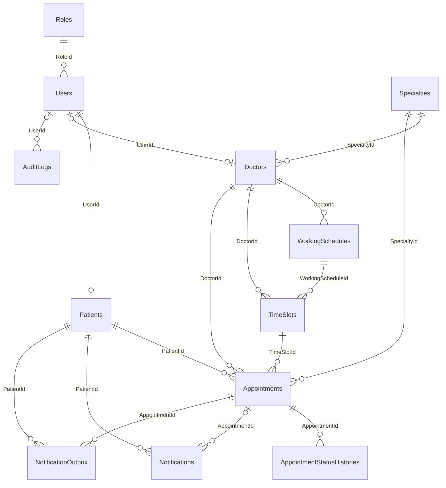

# Cơ sở dữ liệu triển khai

Cập nhật OOAD A2 ngày 18/11/2026: thêm migration `SingleDoctorSpecialty`, thay bảng `DoctorSpecialties` bằng FK `Doctors.SpecialtyId`. Hiện có **12 bảng nghiệp vụ**, ngoài bảng EF `__EFMigrationsHistory`. Các phần khác kế thừa schema Phase 8; lịch định kỳ và sự kiện mới của báo cáo lần 04 sẽ được bổ sung ở các đợt tiếp theo. Xem [ánh xạ OOAD](ooad-model-mapping.md) và [hướng dẫn migration A2](single-specialty-migration.md).

## 1. Quan hệ chính

Sơ đồ tập trung quan hệ nghiệp vụ. Các FK người tạo/tiếp nhận/đóng khung và hành vi xóa được ghi đầy đủ trong từng bảng bên dưới. `Doctors.UserId` tùy chọn: có thể tạo hồ sơ bác sĩ trước khi cấp tài khoản. Mỗi bác sĩ bắt buộc có đúng một chuyên khoa hiện hành; lịch hẹn giữ chuyên khoa riêng để bảo toàn lịch sử khi bác sĩ chuyển chuyên khoa.

## 2. Ràng buộc và trách nhiệm nghiệp vụ

- PK/FK, NOT NULL, độ dài, unique và filtered index do SQL bảo vệ. Các bảng hiện tại **không có CHECK constraint**; quy tắc 30 phút, giờ kết thúc, chồng lấn, hạn hai giờ và chuyển trạng thái được kiểm tra trong service/transaction.
- `Appointments.TimeSlotId` unique khi Status thuộc `(0,2)`: một slot có nhiều lịch sử nhưng tối đa một Confirmed/CheckedIn. NoShow/Cancelled không xóa Appointment.
- `(BookedBy, RequestKey)` unique khi key khác NULL; fingerprint kiểm tra key không bị dùng cho nội dung khác. Key NULL giữ tương thích dữ liệu seed/cũ.
- `Appointments.RowVersion` và `TimeSlots.RowVersion` là rowversion SQL 8 byte, không phải thời gian. EF dùng để phát hiện sửa đồng thời. Serializable và execution strategy bảo vệ chuỗi kiểm tra–ghi.
- `Notifications.OutboxId` unique khi khác NULL để chống giao lặp. OutboxId không có FK trong mapping hiện tại; dispatcher quản lý liên kết. Tương tự, OldTimeSlotId/NewTimeSlotId của lịch sử là dấu vết Id, không phải FK.
- `Users.TokenVersion` hỗ trợ thu hồi phiên. Doctor.FullName tồn tại độc lập tài khoản, service đồng bộ khi hồ sơ được liên kết.
- Mọi giá trị GUID, ngày tạo và mặc định không có SQL DEFAULT trong bảng dưới do ứng dụng/EF cấp. Không giả định `NEWSEQUENTIALID()` hoặc `GETUTCDATE()` trên mọi bảng.
- Lịch khám dùng `date`/`time` theo giờ Việt Nam. Thời điểm thao tác, audit và outbox lưu UTC; UI chuyển sang UTC+7.

| Enum | Giá trị lưu |
|---|---|
| UserRole | Patient=1, Doctor=2, Staff=3, Admin=4 |
| Gender | Other=0, Male=1, Female=2 |
| AppointmentStatus | Confirmed=0, Cancelled=1, CheckedIn=2, NoShow=3 |
| TimeSlotStatus | Open=0, Closed=1, Occupied=2 |
| NotificationType | Confirmed=0, Rescheduled=1, Cancelled=2, Reminder=3 |

## 3. Migration và dữ liệu khởi tạo

Migration trong `src/Hospital.Infrastructure/Data/Migrations`:

1. `20261016125545_InitialCreate`: schema nền tảng.
2. `20261016143621_Phase3Backend`: tên bác sĩ độc lập, TokenVersion, idempotency, outbox và các ràng buộc backend.

Áp dụng migration bằng `dotnet ef database update --project src/Hospital.Infrastructure --startup-project src/Hospital.Api`; đặt connection string/Development trước theo [hướng dẫn demo](demo-guide.md). Không sửa migration đã áp dụng để đồng bộ database đang dùng; thay đổi schema tiếp theo cần migration mới.

Seeder chỉ chạy khi Users chưa có dữ liệu và bật seed trong Development:

| Dữ liệu mới | Số lượng / nội dung |
|---|---|
| Roles | 4, Id cố định 1–4, không IDENTITY |
| Users | 6: admin, staff1, doctor1, doctor2, patient1, patient2 |
| Patients / Doctors / Specialties | 2 / 2 / 5 |
| WorkingSchedules | 14 ca trong 7 ngày, tính cả hôm seed |
| TimeSlots | 98 khung, mỗi ca 7 khung 30 phút |
| Appointments | 2 Confirmed ngày mai: patient1/doctor1 08:30; patient2/doctor2 14:00 |
| Thông báo / audit | 1 Notification ban đầu, 2 reminder outbox tương lai, 1 audit seed |

Hai ca mỗi ngày: doctor1 08:00–11:30, doctor2 13:30–17:00. Database đã có Users không tự seed lại hoặc dời lịch cũ. Khi demo tuần khác, tạo ca mới bằng Desktop. Thông báo/outbox thay đổi theo worker và thao tác sau seed nên không dùng số đếm ban đầu để kết luận dữ liệu chạy lâu bị sai.

## 4. Từ điển dữ liệu và index thực tế

`NULL` ghi rõ khả năng thiếu giá trị; `—` trong Default nghĩa là không có SQL default. Index dưới đây không lặp lại PK. `NO_ACTION` giữ quan hệ khi xóa; các màn hình nghiệp vụ thường ngừng hoạt động thay vì xóa dữ liệu có lịch sử.

### 4.1. Roles

| Cột | Kiểu SQL | NULL | Khóa / tự sinh | SQL Default |
|---|---|---|---|---|
| Id | int | Không | PK | — |
| Name | nvarchar(50) | Không | — | — |
| Description | nvarchar(200) | Có | — | — |

Index:

| Tên | Cột | Unique | Filter |
|---|---|---|---|
| IX_Roles_Name | Name | Có | — |

### 4.2. Users

| Cột | Kiểu SQL | NULL | Khóa / tự sinh | SQL Default |
|---|---|---|---|---|
| Id | uniqueidentifier | Không | PK | `(newsequentialid())` |
| Username | nvarchar(50) | Không | — | — |
| PasswordHash | nvarchar(256) | Không | — | — |
| Email | nvarchar(100) | Không | — | — |
| PhoneNumber | nvarchar(20) | Có | — | — |
| FullName | nvarchar(100) | Không | — | — |
| RoleId | int | Không | — | — |
| IsActive | bit | Không | — | `(CONVERT([bit],(1)))` |
| CreatedAt | datetime2(7) | Không | — | `(getutcdate())` |
| UpdatedAt | datetime2(7) | Có | — | — |
| LastLoginAt | datetime2(7) | Có | — | — |
| TokenVersion | int | Không | — | `((0))` |

Khóa ngoại:

| Cột | Tham chiếu | ON DELETE |
|---|---|---|
| RoleId | Roles.Id | NO_ACTION |

Index:

| Tên | Cột | Unique | Filter |
|---|---|---|---|
| IX_Users_Email | Email | Có | — |
| IX_Users_RoleId | RoleId | Không | — |
| IX_Users_Username | Username | Có | — |

### 4.3. Patients

| Cột | Kiểu SQL | NULL | Khóa / tự sinh | SQL Default |
|---|---|---|---|---|
| Id | uniqueidentifier | Không | PK | `(newsequentialid())` |
| UserId | uniqueidentifier | Không | — | — |
| DateOfBirth | date | Không | — | — |
| Gender | tinyint | Không | — | — |
| Address | nvarchar(300) | Có | — | — |
| PatientCode | nvarchar(20) | Không | — | — |
| CreatedAt | datetime2(7) | Không | — | — |
| UpdatedAt | datetime2(7) | Có | — | — |

Khóa ngoại:

| Cột | Tham chiếu | ON DELETE |
|---|---|---|
| UserId | Users.Id | CASCADE |

Index:

| Tên | Cột | Unique | Filter |
|---|---|---|---|
| IX_Patients_PatientCode | PatientCode | Có | — |
| IX_Patients_UserId | UserId | Có | — |

### 4.4. Specialties

| Cột | Kiểu SQL | NULL | Khóa / tự sinh | SQL Default |
|---|---|---|---|---|
| Id | int | Không | PK, IDENTITY | — |
| Code | nvarchar(20) | Không | — | — |
| Name | nvarchar(100) | Không | — | — |
| Description | nvarchar(500) | Có | — | — |
| IsActive | bit | Không | — | `(CONVERT([bit],(1)))` |
| CreatedAt | datetime2(7) | Không | — | — |
| UpdatedAt | datetime2(7) | Có | — | — |
| CreatedBy | uniqueidentifier | Có | — | — |

Khóa ngoại:

| Cột | Tham chiếu | ON DELETE |
|---|---|---|
| CreatedBy | Users.Id | NO_ACTION |

Index:

| Tên | Cột | Unique | Filter |
|---|---|---|---|
| IX_Specialties_Code | Code | Có | — |
| IX_Specialties_CreatedBy | CreatedBy | Không | — |
| IX_Specialties_Name | Name | Có | — |

### 4.5. Doctors

| Cột | Kiểu SQL | NULL | Khóa / tự sinh | SQL Default |
|---|---|---|---|---|
| Id | uniqueidentifier | Không | PK | `(newsequentialid())` |
| UserId | uniqueidentifier | Có | — | — |
| DoctorCode | nvarchar(20) | Không | — | — |
| Title | nvarchar(50) | Có | — | — |
| Bio | nvarchar(1000) | Có | — | — |
| AvatarUrl | nvarchar(500) | Có | — | — |
| IsActive | bit | Không | — | `(CONVERT([bit],(1)))` |
| CreatedAt | datetime2(7) | Không | — | — |
| UpdatedAt | datetime2(7) | Có | — | — |
| CreatedBy | uniqueidentifier | Có | — | — |
| FullName | nvarchar(100) | Không | — | `(N'')` |

Khóa ngoại:

| Cột | Tham chiếu | ON DELETE |
|---|---|---|
| CreatedBy | Users.Id | NO_ACTION |
| UserId | Users.Id | SET_NULL |

Index:

| Tên | Cột | Unique | Filter |
|---|---|---|---|
| IX_Doctors_CreatedBy | CreatedBy | Không | — |
| IX_Doctors_DoctorCode | DoctorCode | Có | — |
| IX_Doctors_UserId | UserId | Có | ([UserId] IS NOT NULL) |
| IX_Doctors_SpecialtyId | SpecialtyId | Không | — |

Bổ sung A2: `Doctors.SpecialtyId` kiểu `int`, NOT NULL, FK tới `Specialties.Id`, ON DELETE NO_ACTION, không có default. Migration chép từ liên kết cũ chỉ khi mỗi bác sĩ có đúng một chuyên khoa.

### 4.6. DoctorSpecialties trong phiên bản trước A2

Bảng dưới đây chỉ mô tả schema cũ để đối chiếu migration. Bảng này đã bị loại khỏi schema hiện hành sau khi chép sang `Doctors.SpecialtyId`.

| Cột | Kiểu SQL | NULL | Khóa / tự sinh | SQL Default |
|---|---|---|---|---|
| DoctorId | uniqueidentifier | Không | PK | — |
| SpecialtyId | int | Không | PK | — |
| IsPrimary | bit | Không | — | — |

Khóa ngoại:

| Cột | Tham chiếu | ON DELETE |
|---|---|---|
| DoctorId | Doctors.Id | CASCADE |
| SpecialtyId | Specialties.Id | CASCADE |

Index:

| Tên | Cột | Unique | Filter |
|---|---|---|---|
| IX_DoctorSpecialties_SpecialtyId | SpecialtyId | Không | — |

### 4.7. WorkingSchedules

| Cột | Kiểu SQL | NULL | Khóa / tự sinh | SQL Default |
|---|---|---|---|---|
| Id | uniqueidentifier | Không | PK | — |
| DoctorId | uniqueidentifier | Không | — | — |
| WorkDate | date | Không | — | — |
| StartTime | time(7) | Không | — | — |
| EndTime | time(7) | Không | — | — |
| Note | nvarchar(500) | Có | — | — |
| CreatedAt | datetime2(7) | Không | — | — |
| UpdatedAt | datetime2(7) | Có | — | — |
| CreatedBy | uniqueidentifier | Có | — | — |

Khóa ngoại:

| Cột | Tham chiếu | ON DELETE |
|---|---|---|
| CreatedBy | Users.Id | NO_ACTION |
| DoctorId | Doctors.Id | CASCADE |

Index:

| Tên | Cột | Unique | Filter |
|---|---|---|---|
| IX_WorkingSchedules_CreatedBy | CreatedBy | Không | — |
| IX_WorkingSchedules_DoctorId_WorkDate_StartTime | DoctorId, WorkDate, StartTime | Có | — |

### 4.8. TimeSlots

| Cột | Kiểu SQL | NULL | Khóa / tự sinh | SQL Default |
|---|---|---|---|---|
| Id | uniqueidentifier | Không | PK | — |
| WorkingScheduleId | uniqueidentifier | Không | — | — |
| DoctorId | uniqueidentifier | Không | — | — |
| SlotDate | date | Không | — | — |
| StartTime | time(7) | Không | — | — |
| EndTime | time(7) | Không | — | — |
| Status | tinyint | Không | — | — |
| IsActive | bit | Không | — | — |
| ClosedReason | nvarchar(500) | Có | — | — |
| ClosedAt | datetime2(7) | Có | — | — |
| ClosedBy | uniqueidentifier | Có | — | — |
| CreatedAt | datetime2(7) | Không | — | — |
| RowVersion | rowversion (8 byte) | Không | SQL rowversion | — |

Khóa ngoại:

| Cột | Tham chiếu | ON DELETE |
|---|---|---|
| ClosedBy | Users.Id | NO_ACTION |
| DoctorId | Doctors.Id | NO_ACTION |
| WorkingScheduleId | WorkingSchedules.Id | CASCADE |

Index:

| Tên | Cột | Unique | Filter |
|---|---|---|---|
| IX_TimeSlots_ClosedBy | ClosedBy | Không | — |
| IX_TimeSlots_DoctorId_SlotDate_StartTime | DoctorId, SlotDate, StartTime | Không | — |
| IX_TimeSlots_DoctorId_SlotDate_Status | DoctorId, SlotDate, Status | Không | — |
| IX_TimeSlots_WorkingScheduleId | WorkingScheduleId | Không | — |

### 4.9. Appointments

| Cột | Kiểu SQL | NULL | Khóa / tự sinh | SQL Default |
|---|---|---|---|---|
| Id | uniqueidentifier | Không | PK | — |
| AppointmentCode | nvarchar(20) | Không | — | — |
| PatientId | uniqueidentifier | Không | — | — |
| DoctorId | uniqueidentifier | Không | — | — |
| TimeSlotId | uniqueidentifier | Không | — | — |
| SpecialtyId | int | Không | — | — |
| AppointmentDate | date | Không | — | — |
| StartTime | time(7) | Không | — | — |
| EndTime | time(7) | Không | — | — |
| Status | tinyint | Không | — | — |
| Notes | nvarchar(1000) | Có | — | — |
| CancellationReason | nvarchar(500) | Có | — | — |
| RescheduleReason | nvarchar(500) | Có | — | — |
| BookedBy | uniqueidentifier | Không | — | — |
| CheckedInBy | uniqueidentifier | Có | — | — |
| CheckedInAt | datetime2(7) | Có | — | — |
| MarkedNoShowBy | uniqueidentifier | Có | — | — |
| MarkedNoShowAt | datetime2(7) | Có | — | — |
| CreatedAt | datetime2(7) | Không | — | — |
| UpdatedAt | datetime2(7) | Có | — | — |
| RowVersion | rowversion (8 byte) | Không | SQL rowversion | — |
| RequestFingerprint | nvarchar(64) | Có | — | — |
| RequestKey | uniqueidentifier | Có | — | — |

Khóa ngoại:

| Cột | Tham chiếu | ON DELETE |
|---|---|---|
| BookedBy | Users.Id | NO_ACTION |
| CheckedInBy | Users.Id | NO_ACTION |
| MarkedNoShowBy | Users.Id | NO_ACTION |
| DoctorId | Doctors.Id | NO_ACTION |
| PatientId | Patients.Id | NO_ACTION |
| SpecialtyId | Specialties.Id | NO_ACTION |
| TimeSlotId | TimeSlots.Id | NO_ACTION |

Index:

| Tên | Cột | Unique | Filter |
|---|---|---|---|
| IX_Appointments_AppointmentCode | AppointmentCode | Có | — |
| IX_Appointments_BookedBy_RequestKey | BookedBy, RequestKey | Có | ([RequestKey] IS NOT NULL) |
| IX_Appointments_CheckedInBy | CheckedInBy | Không | — |
| IX_Appointments_DoctorId_AppointmentDate | DoctorId, AppointmentDate | Không | — |
| IX_Appointments_MarkedNoShowBy | MarkedNoShowBy | Không | — |
| IX_Appointments_PatientId_AppointmentDate | PatientId, AppointmentDate | Không | — |
| IX_Appointments_SpecialtyId | SpecialtyId | Không | — |
| IX_Appointments_Status | Status | Không | — |
| IX_Appointments_TimeSlotId | TimeSlotId | Có | ([Status] IN ((0), (2))) |

### 4.10. AppointmentStatusHistories

| Cột | Kiểu SQL | NULL | Khóa / tự sinh | SQL Default |
|---|---|---|---|---|
| Id | bigint | Không | PK, IDENTITY | — |
| AppointmentId | uniqueidentifier | Không | — | — |
| OldStatus | tinyint | Có | — | — |
| NewStatus | tinyint | Không | — | — |
| Reason | nvarchar(500) | Có | — | — |
| ChangedBy | uniqueidentifier | Không | — | — |
| ChangedAt | datetime2(7) | Không | — | — |
| OldTimeSlotId | uniqueidentifier | Có | — | — |
| NewTimeSlotId | uniqueidentifier | Có | — | — |

Khóa ngoại:

| Cột | Tham chiếu | ON DELETE |
|---|---|---|
| ChangedBy | Users.Id | NO_ACTION |
| AppointmentId | Appointments.Id | CASCADE |

Index:

| Tên | Cột | Unique | Filter |
|---|---|---|---|
| IX_AppointmentStatusHistories_AppointmentId | AppointmentId | Không | — |
| IX_AppointmentStatusHistories_ChangedBy | ChangedBy | Không | — |

### 4.11. Notifications

| Cột | Kiểu SQL | NULL | Khóa / tự sinh | SQL Default |
|---|---|---|---|---|
| Id | uniqueidentifier | Không | PK | — |
| PatientId | uniqueidentifier | Không | — | — |
| AppointmentId | uniqueidentifier | Có | — | — |
| Type | tinyint | Không | — | — |
| Title | nvarchar(200) | Không | — | — |
| Message | nvarchar(1000) | Không | — | — |
| IsRead | bit | Không | — | — |
| ReadAt | datetime2(7) | Có | — | — |
| CreatedAt | datetime2(7) | Không | — | — |
| ScheduledFor | datetime2(7) | Có | — | — |
| IsSent | bit | Không | — | — |
| OutboxId | uniqueidentifier | Có | — | — |

Khóa ngoại:

| Cột | Tham chiếu | ON DELETE |
|---|---|---|
| PatientId | Patients.Id | CASCADE |
| AppointmentId | Appointments.Id | SET_NULL |

Index:

| Tên | Cột | Unique | Filter |
|---|---|---|---|
| IX_Notifications_AppointmentId | AppointmentId | Không | — |
| IX_Notifications_PatientId_CreatedAt | PatientId, CreatedAt | Không | — |
| IX_Notifications_OutboxId | OutboxId | Có | ([OutboxId] IS NOT NULL) |

### 4.12. NotificationOutbox

| Cột | Kiểu SQL | NULL | Khóa / tự sinh | SQL Default |
|---|---|---|---|---|
| Id | uniqueidentifier | Không | PK | — |
| PatientId | uniqueidentifier | Không | — | — |
| AppointmentId | uniqueidentifier | Không | — | — |
| Type | tinyint | Không | — | — |
| Title | nvarchar(200) | Không | — | — |
| Message | nvarchar(1000) | Không | — | — |
| ScheduledFor | datetime2(7) | Không | — | — |
| DeliveredAt | datetime2(7) | Có | — | — |
| SuppressedAt | datetime2(7) | Có | — | — |

Khóa ngoại:

| Cột | Tham chiếu | ON DELETE |
|---|---|---|
| PatientId | Patients.Id | NO_ACTION |
| AppointmentId | Appointments.Id | NO_ACTION |

Index:

| Tên | Cột | Unique | Filter |
|---|---|---|---|
| IX_NotificationOutbox_AppointmentId | AppointmentId | Không | — |
| IX_NotificationOutbox_DeliveredAt_SuppressedAt_ScheduledFor | DeliveredAt, SuppressedAt, ScheduledFor | Không | — |
| IX_NotificationOutbox_PatientId | PatientId | Không | — |

### 4.13. AuditLogs

| Cột | Kiểu SQL | NULL | Khóa / tự sinh | SQL Default |
|---|---|---|---|---|
| Id | bigint | Không | PK, IDENTITY | — |
| UserId | uniqueidentifier | Có | — | — |
| Action | nvarchar(100) | Không | — | — |
| EntityType | nvarchar(100) | Không | — | — |
| EntityId | nvarchar(50) | Có | — | — |
| OldValues | nvarchar(max) | Có | — | — |
| NewValues | nvarchar(max) | Có | — | — |
| IpAddress | nvarchar(50) | Có | — | — |
| CreatedAt | datetime2(7) | Không | — | — |

Khóa ngoại:

| Cột | Tham chiếu | ON DELETE |
|---|---|---|
| UserId | Users.Id | SET_NULL |

Index:

| Tên | Cột | Unique | Filter |
|---|---|---|---|
| IX_AuditLogs_EntityType_EntityId | EntityType, EntityId | Không | — |
| IX_AuditLogs_UserId_CreatedAt | UserId, CreatedAt | Không | — |

## 5. Bằng chứng và mã nguồn

Nguồn mapping: `HospitalDbContext`, migrations và entities trong Domain. Metadata bảng/index/FK đã đọc trên SQL Server thật; 28 kiểm thử SQL xác minh cạnh tranh, rollback, quyền và lịch sử. Xem [Phase 7](phase7-verification.md), [Phase 8](phase8-verification.md) và [giải thích transaction/outbox](technical-explanation.md).
